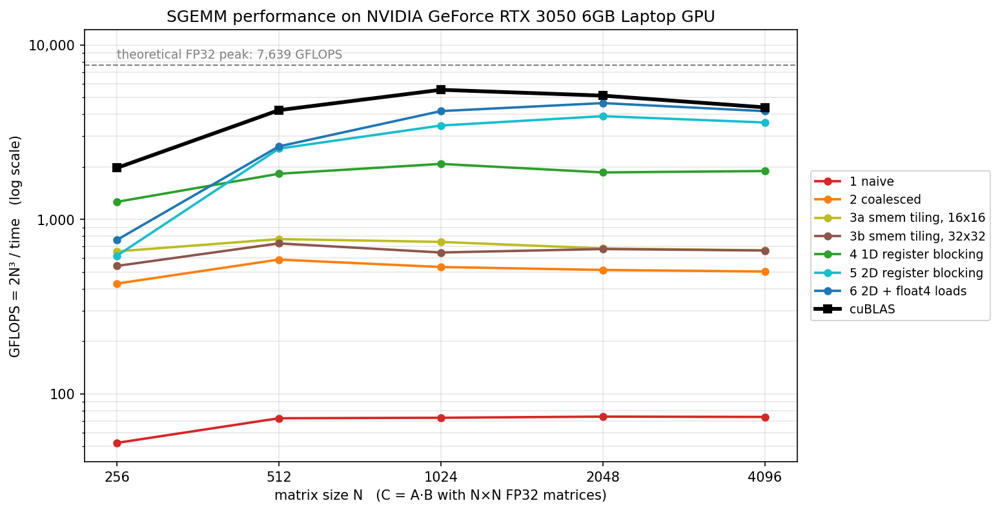
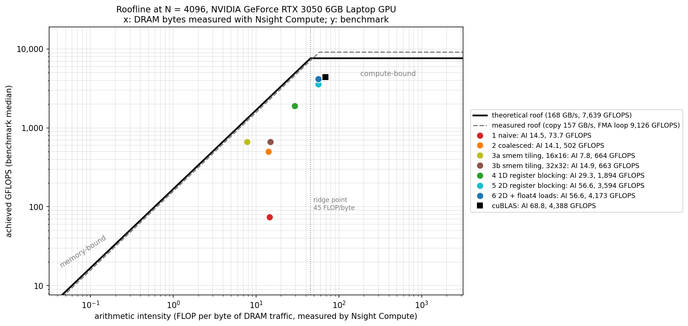

# SGEMM from scratch: optimizing matrix multiply on an RTX 3050 Laptop GPU

{{SUMMARY}}

| | |
|---|---|
| GPU | {{GPU_LINE}} |
| Theoretical peak | {{PEAK_LINE}} |
| Toolchain | CUDA {{CUDA_VERSION}}, driver {{DRIVER}}, Ubuntu 24.04, gcc 13 |
| Docs | [docs/LEARN.md](docs/LEARN.md) (CUDA from zero, kernel by kernel) · [docs/INTERVIEW.md](docs/INTERVIEW.md) (20 Q&A with these numbers) · [docs/RESUME.md](docs/RESUME.md) |

## Results

Square N×N FP32 matrices, C = A·B. Times are the median of 10 runs after 3 warm-ups (CUDA events).
Every kernel's output was checked element by element against cuBLAS before it was timed (and against a
double-precision CPU reference for N ≤ 512). cuBLAS runs in its default FP32 mode (no TF32 tensor cores),
so it does the same arithmetic as our kernels.

<!-- RESULTS:BEGIN -->
<!-- RESULTS:END -->





All tables, including registers, occupancy and the Nsight Compute counters, are in
[results/results.md](results/results.md). Raw data: [results/results.csv](results/results.csv),
[results/kernels.csv](results/kernels.csv), [results/ncu/](results/ncu/),
[results/device.md](results/device.md).

## What limits each kernel

{{LIMITS}}

## Build and run

Requirements: an NVIDIA GPU and driver, the CUDA toolkit (nvcc + cuBLAS; Nsight Compute is optional), and
Python 3 with matplotlib and pandas (`pip install -r requirements.txt`).

```bash
make bench        # build, device info, benchmark, Nsight Compute profile (if permitted), charts
```

That one command runs, in order:

| Step | Command | Output |
|---|---|---|
| Device info | `./bin/device_info results` | `results/device.md`, `results/device.json` |
| Benchmark | `./bin/sgemm` | `results/results.csv`, `results/kernels.csv` |
| Profiling | `scripts/profile.sh 4096` | `results/ncu/` (skipped with a message if not permitted) |
| Charts + tables | `scripts/report.py` | `results/gflops.png`, `results/roofline.png`, `results/results.md`, this README's results table |

Useful variations:

```bash
make                                          # build only
./bin/sgemm --sizes 2048 --kernels 5_regblock_2d,6_vectorized   # quick experiment
./bin/sgemm --help
make profile PROFILE_N=2048                   # profile at another size
make PYTHON=~/venv/bin/python report          # if your python3 lacks matplotlib/pandas
make info                                     # show detected nvcc, GPU architecture, python
```

The Makefile finds `nvcc` (on `PATH` or in `/usr/local/cuda*`) and compiles for the compute capability
`nvidia-smi` reports, here `sm_{{CC_NODOT}}`. Machine-specific overrides (e.g. `PYTHON := ...`) can go in a
git-ignored `local.mk`.

## Setup notes for this machine (Ubuntu 24.04, driver 580)

**CUDA toolkit.** The driver alone does not include `nvcc`. The toolkit was installed from NVIDIA's runfile
for CUDA 13.0.0, which ships with exactly this driver version (580.65.06). The `--toolkit` flag installs
only the toolkit (nvcc, cuBLAS, Nsight Compute) under `/usr/local/cuda-13.0` and leaves the display driver
alone:

```bash
wget https://developer.download.nvidia.com/compute/cuda/13.0.0/local_installers/cuda_13.0.0_580.65.06_linux.run
sudo sh cuda_13.0.0_580.65.06_linux.run --silent --toolkit
```

**Profiling permission.** By default only root may read GPU performance counters, and `ncu` then fails
with `ERR_NVGPUCTRPERM`. To allow normal users, run the following and then reboot:

```bash
echo 'options nvidia NVreg_RestrictProfilingToAdminUsers=0' | sudo tee /etc/modprobe.d/nvidia-profiling.conf
sudo update-initramfs -u -k all
sudo reboot
# check: grep RmProfilingAdminOnly /proc/driver/nvidia/params   ->  RmProfilingAdminOnly: 0
```

Without it, `make bench` still works: it skips profiling and the roofline uses analytical arithmetic
intensities.

## Project layout

```text
src/
  kernels/01_naive.cu        1  one thread per output, uncoalesced mapping
  kernels/02_coalesced.cu    2  same, coalesced mapping
  kernels/03_smem_tiled.cu   3  shared-memory tiling, TILE = 16 and 32
  kernels/04_regblock_1d.cu  4  1D register blocking (8 outputs per thread)
  kernels/05_regblock_2d.cu  5  2D register blocking (8x8 outputs per thread)
  kernels/06_vectorized.cu   6  kernel 5 + float4 loads, transposed A tile
  bench.cu                   harness: inputs, cuBLAS/CPU references, checks, timing, CSV
  device_info.cu             STEP 1: device properties, theoretical peaks, microbenchmarks
  device_query.cuh  gpu_monitor.cuh  kernels.cuh  common.cuh
scripts/
  profile.sh                 Nsight Compute collection
  ncu_summary.py             condenses the ncu export
  report.py                  charts + tables
results/                     everything measured (committed)
docs/                        LEARN.md, INTERVIEW.md, RESUME.md
```

## Methodology and honesty notes

{{METHODOLOGY}}

## Acknowledgements

The kernel progression follows the well-known structure of Simon Boehm's "How to Optimize a CUDA Matmul
Kernel for cuBLAS-like Performance" and the CUDA C++ Programming Guide. All code here was written for this
project, and every number was measured on the machine described above.
